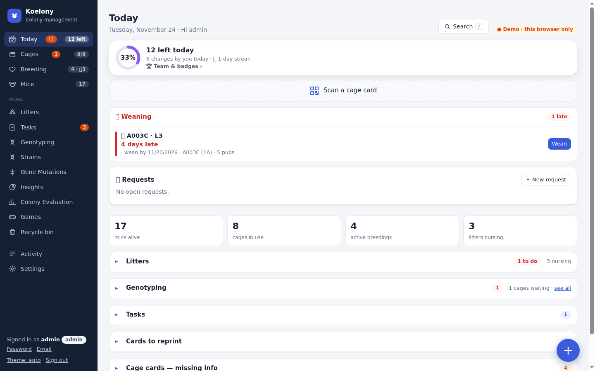
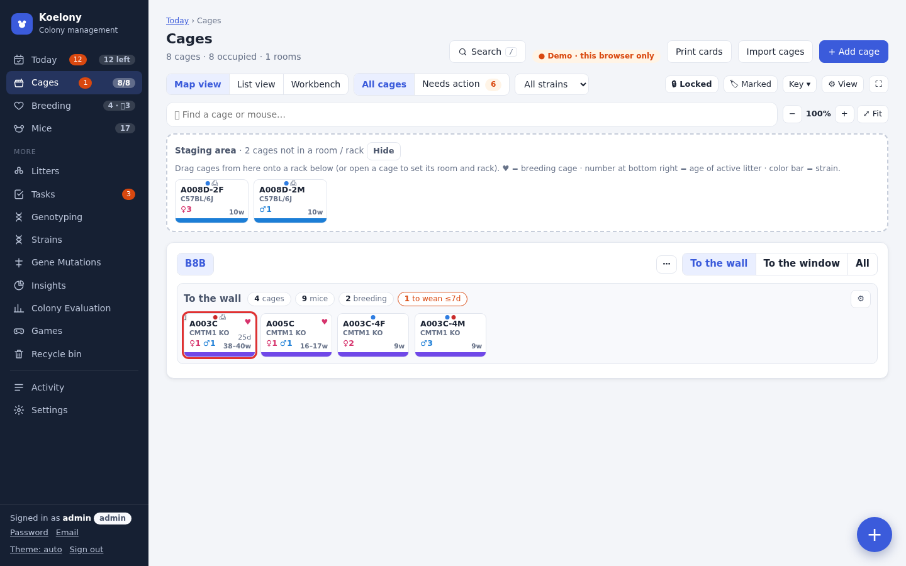
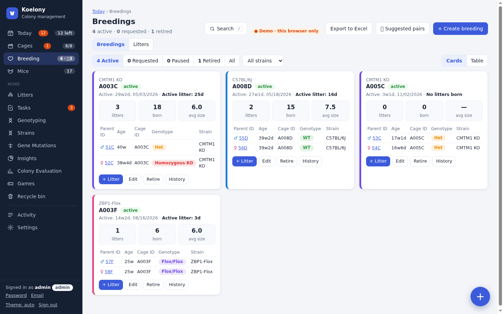
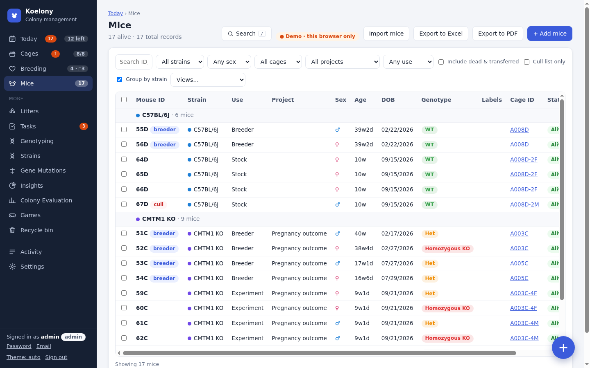

# Koelony

A mouse colony management web app for research labs, written by a research scientist for a working biology lab, where it is in daily use.

Koelony is a single-page app (vanilla HTML/CSS/JS) plus a small PHP API. It runs on almost any basic PHP host, installs on phones as a PWA, and can also run with no server at all: open index.html by itself and it works in demo mode with data stored in the browser.

Current version: **V139**

## Screenshots

Captured from the built-in demo mode (sample data only).

| | |
|---|---|
|  |  |
|  |  |

More: [sign-in screen](screenshots/login.png), [strains](screenshots/strains.png).

## Features

- Today view with the day's tasks: weans due, biopsies, genotyping, and more
- Track strains, mutations, mice, breedings, litters, and cages
- Printable cage cards with QR codes; scan a cage with a phone camera to jump straight to it
- Colony evaluation and insights
- Import mice and cages from Excel or CSV (for example a Transnetyx export)
- Multi-user sign-in with roles: admin, editor, trainee, viewer
- Activity log and undo
- Optional daily email report, sent through a Gmail account with an app password (or any SMTP server)
- Installable PWA with an offline app shell; printable reports and PDF export
- Customizable themes, including dark modes

## Requirements

- PHP 7.4 or newer (any basic web host with session support works)
- Apache recommended: the app ships .htaccess files that protect the data folder and set cache headers. On nginx or another server, block web access to colony-data/ yourself
- HTTPS, needed for "Install app" and for scanning QR codes with the camera

## Install

1. Upload all of these files into a folder on your PHP host:
   index.html, api.php, manifest.json, sw.js, icon-180.png, icon-192.png, icon-512.png, icon-maskable-512.png
2. Open the site over HTTPS. api.php creates a protected `colony-data` folder next to itself on first use. That folder holds all data and logins: never delete it, and never publish it.
3. Sign in as **admin / admin123**. You will be asked to choose a new password before you can continue.
4. Phones: open the site, then menu (≡) → "Add to Home Screen" / "Install app".
5. Optional daily email report: Settings → Daily email report. Use a Gmail account with 2-Step Verification and an App password. Each person adds their email under menu → "My email & daily report" (or an admin does it on the Users page).
   Optional exact-time sending: a cron service can call `https://YOURSITE/api.php?action=cron&key=THE_KEY` (the key is shown in colony-data/mail.php after email settings are saved). Without cron, the built-in "first visit after 7 AM" trigger sends the report.
6. Print cage cards with QR codes: + button → Print cage cards.

## Security notes

- The default **admin / admin123** bootstrap login exists by design so a fresh install is reachable. The app forces a password change on first sign-in; do not skip it, and give the admin account a strong password.
- All data, user accounts, sessions, and the saved SMTP app password live in `colony-data/`. The app writes an .htaccess containing `Require all denied` into that folder so Apache never serves it. On other web servers, configure the same protection yourself.
- Passwords are hashed with PHP `password_hash` (bcrypt). Sessions use httponly, SameSite=Strict cookies and are stored inside the protected data folder.
- Serve the app over HTTPS only.
- Never commit or publish `colony-data/`. It is excluded in .gitignore.

## License

MIT, see [LICENSE](LICENSE).
